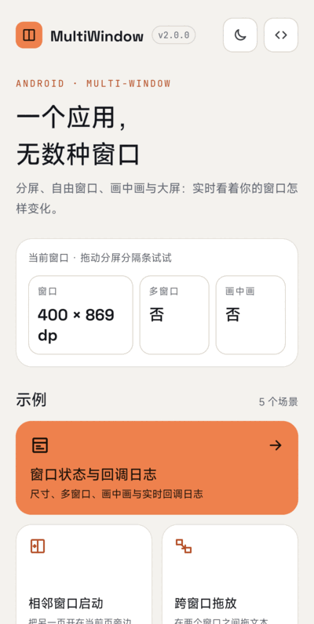
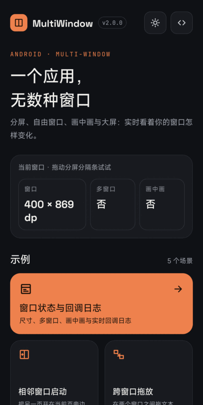
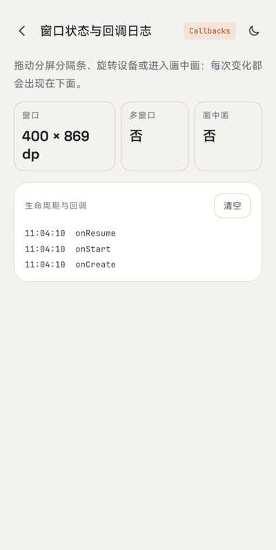
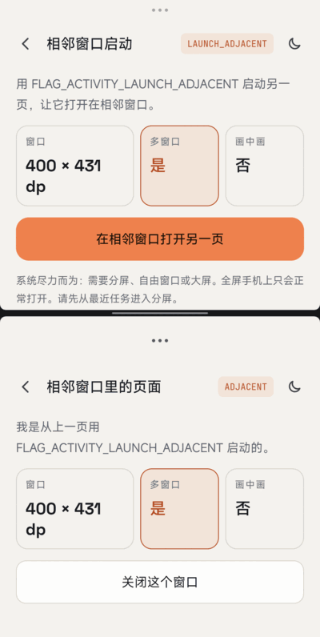
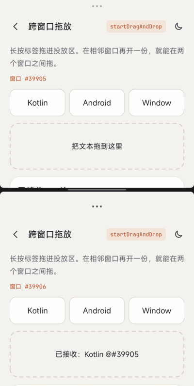
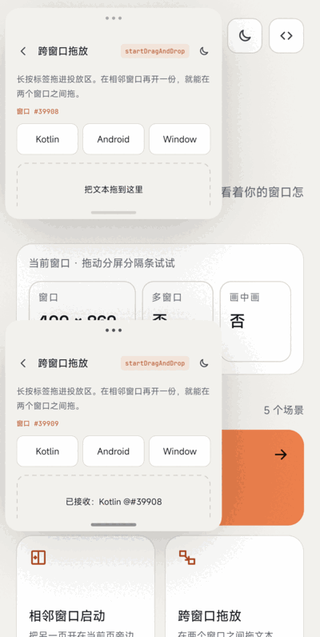
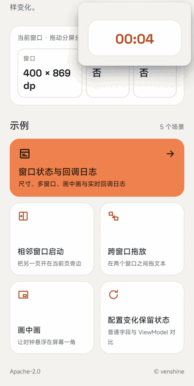
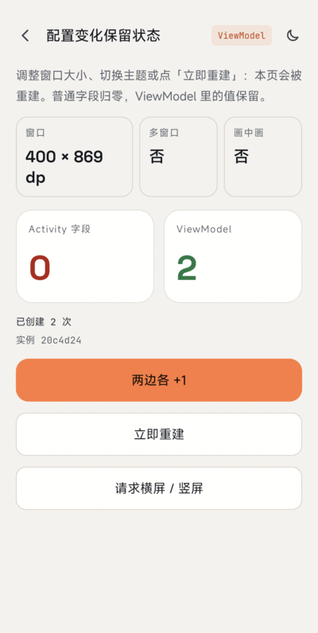

# MultiWindow

[](https://android-arsenal.com/api?level=24)

[English](README.md)

一个 Kotlin 写的 **Android 多窗口 / 大屏适配演示 App**：实时显示窗口尺寸、是否多窗口、是否画中画，在相邻窗口打开另一个页面，跨窗口拖放文本，配置变化后日志不丢。这是演示 App，不是库（没有 Maven 坐标）。

- 版本 2.0.0，minSdk 24，targetSdk 36，Kotlin，AppCompat DayNight（不使用 Material Components）。
- 示例 APK 见 [Releases 页面](https://github.com/venshine/MultiWindow/releases)。

## 截图


| 首页 | 深色模式 | 状态与回调 | 相邻窗口启动 |
|:---:|:---:|:---:|:---:|
|  |  |  |  |

| 分屏拖放 | 自由窗口拖放 | 画中画 | ViewModel |
|:---:|:---:|:---:|:---:|
|  |  |  |  |

拍摄设备：小米 2509FPN0BC，Android 17（API 37）。分屏由「相邻窗口启动」按钮产生，自由窗口由 `adb shell am start --windowingMode 5` 打开。

## 演示内容

| 功能 | 位置 |
|---|---|
| 实时窗口尺寸（`Configuration.screenWidthDp/HeightDp`）、多窗口与画中画状态 | `BaseActivity`、`StatusActivity` |
| 回调：`onMultiWindowModeChanged(Boolean, Configuration)`、`onPictureInPictureModeChanged(Boolean, Configuration)` | `BaseActivity.onWindowEvent()` |
| 在相邻窗口启动：`FLAG_ACTIVITY_LAUNCH_ADJACENT or FLAG_ACTIVITY_NEW_TASK` | `AdjacentActivity` |
| 跨窗口文本拖放（`startDragAndDrop` + `DRAG_FLAG_GLOBAL`、`OnDragListener`） | `DragActivity`、`DropParser` |
| 用 `ViewModel` 在重建后保留状态 | `ConfigActivity`、`ConfigViewModel`、`WindowViewModel` |
| 自行处理配置变化（`configChanges`）+ 画中画 | `PipActivity`（及清单里的 `configChanges`） |

```kotlin
// 查询与回调（单参数重载自 API 26 起废弃）
val inMultiWindow = isInMultiWindowMode
override fun onMultiWindowModeChanged(isInMultiWindowMode: Boolean, newConfig: Configuration) { ... }

// 在相邻窗口打开另一个 Activity（尽力而为，不保证成功）
startActivity(
    Intent(this, PeerActivity::class.java)
        .addFlags(Intent.FLAG_ACTIVITY_LAUNCH_ADJACENT or Intent.FLAG_ACTIVITY_NEW_TASK)
)
```

## Android 行为变化（已对照官方文档核实）

以下每条都对照了链接页面原文。

1. **Android 12（API 31）让多窗口成为标准行为。** 大屏（medium / expanded 窗口尺寸类）上所有应用都支持多窗口，与配置无关；`resizeableActivity="false"` 时系统在必要时让应用进入兼容模式。小屏上系统检查 `minWidth` / `minHeight`，`resizeableActivity="false"` 仍会禁止多窗口。[Support multi-window mode](https://developer.android.com/develop/ui/compose/layouts/adaptive/support-multi-window-mode)
2. **Android 12L（API 32）：** Recents 增加 **Split** 操作；`FLAG_ACTIVITY_LAUNCH_ADJACENT` 可以让全屏应用进入分屏并在相邻窗口打开目标页（同一页面「Programmatic split-screen」）。OEM 可以在更低版本启用该行为。
3. **多 resume（Android 10+）：** 多窗口下所有可见 Activity 都保持 `RESUMED`，独占资源（摄像头、麦克风）用 `onTopResumedActivityChanged()`；Android 10 之前只有最近交互的那个处于 resumed。同一页面。
4. **Android 16（API 36），targetSdk 36 的应用：** 在最小宽度 >= 600dp 的屏幕上，`screenOrientation`、`resizeableActivity`、`minAspectRatio`、`maxAspectRatio`、`setRequestedOrientation()`、`getRequestedOrientation()` 均被忽略（应用可调整大小并铺满窗口，不再有黑边）。例外：游戏（`android:appCategory`）、用户在宽高比设置中选择应用默认行为、小于 sw600dp 的屏幕。可用 `PROPERTY_COMPAT_ALLOW_RESTRICTED_RESIZABILITY` 临时退出，**targetSdk 37 起该开关失效**。[Behavior changes: Android 16](https://developer.android.com/about/versions/16/behavior-changes-16)、[App orientation, aspect ratio, and resizability](https://developer.android.com/develop/ui/compose/layouts/adaptive/app-orientation-aspect-ratio-resizability)
   - 对本演示的影响：`AndroidManifest.xml` 里的 `resizeableActivity="true"` 只在小于 sw600dp 或 targetSdk 低于 36 时有意义，大屏上被忽略。旋转和窗口缩放会更频繁地重建 Activity，必须保存状态（[Save UI states](https://developer.android.com/topic/libraries/architecture/saving-states)）。
5. **如何开启自由窗口（桌面窗口）：** 官方文档只写「桌面窗口模式可由大屏设备厂商启用」（[Support multi-window mode](https://developer.android.com/develop/ui/compose/layouts/adaptive/support-multi-window-mode)）。官方开发者预览博客说：用 Android 15 QPR1 Beta 2 的 Pixel Tablet 或 Pixel Tablet 模拟器，然后在开发者选项里选择 **Enable freeform windows**，没有提到 root（[Android Developers Blog，2024-09](https://android-developers.googleblog.com/2024/09/developer-preview-desktop-windowing-on-android-tablets.html)）。所以旧版 README 里「root 后执行 `settings put global enable_freeform_support 1`」不再是官方文档的路径。**单台真机观察（非官方文档）：** 在小米 2509FPN0BC、Android 17（API 37）上，`pm has-feature android.software.freeform_window_management` 返回 true，全局设置 `enable_freeform_support` 为空，`adb shell am start --windowingMode 5 -n <activity>` 能把页面开成自由窗口（两个自由窗口可用 `am task resize` 调整并互相拖放）。面向用户的稳定版开启步骤，以及其他设备 / OEM 固件上是否可用，仍**待确认**。

## 从 1.x 迁移

- 改用 Kotlin；`compileSdk` / `targetSdk` 36，`minSdk` 24（不变）。
- 移除 `com.wx.android.common` 依赖和旧版 support 库；原来的静态 `StringBuilder` 日志改为 `ViewModel`。
- 拖放现在只传纯文本（去掉了图片拖放）。
- 旧 README 里仅适用于 Android N 的步骤（root 开自由窗口）已不适用，见上面第 5 条。

## 替代方案

多窗格界面用 [Activity embedding](https://developer.android.com/develop/ui/views/layout/activity-embedding)（Jetpack WindowManager）；自适应布局用[窗口尺寸类](https://developer.android.com/develop/ui/compose/layouts/adaptive/window-size-classes)。Google 的 [MultiWindowPlayground](https://github.com/googlesamples/android-MultiWindowPlayground) 是 Android N 时代的官方参考。

## 维护状态

作为小型演示低频维护。相邻窗口启动（在该机上产生了真正的上下分屏）、跨窗口拖放、画中画、自由窗口已在小米 2509FPN0BC、Android 17（API 37）上手动验证，自动化测试覆盖不到，其他设备未试。

## 致谢

示例 App 内置了下面两套字体，均采用 [SIL Open Font License 1.1](https://openfontlicense.org)（协议原文见 [`app/licenses/`](app/licenses)）：

* [Space Grotesk](https://github.com/floriankarsten/space-grotesk)：Copyright 2020 The Space Grotesk Project Authors
* [JetBrains Mono](https://github.com/JetBrains/JetBrainsMono)：Copyright 2020 The JetBrains Mono Project Authors

## 许可证

Apache License 2.0，见 [LICENSE](LICENSE)。
