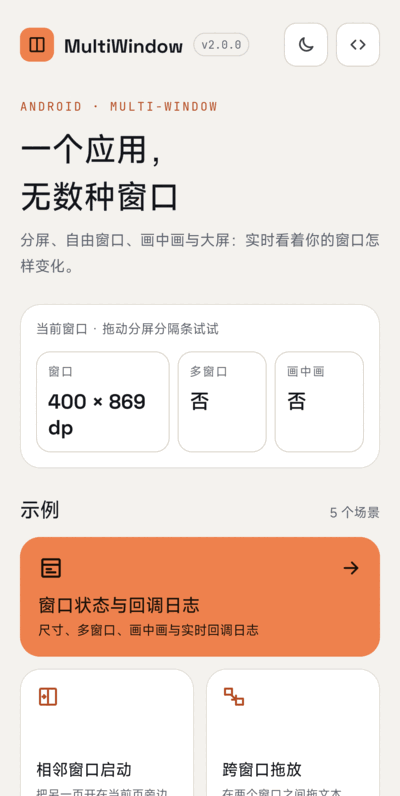
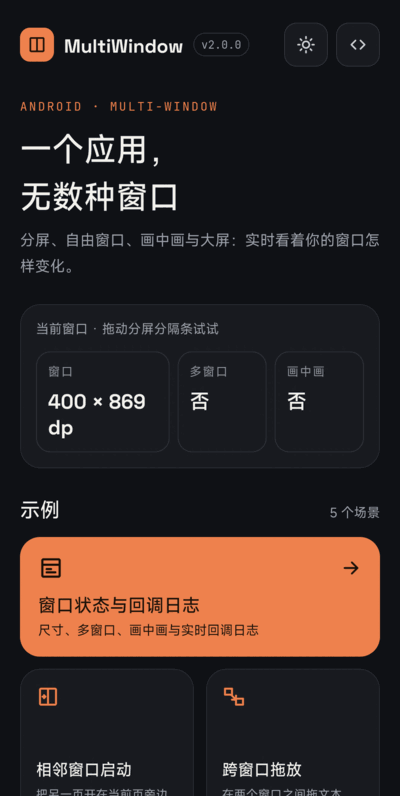
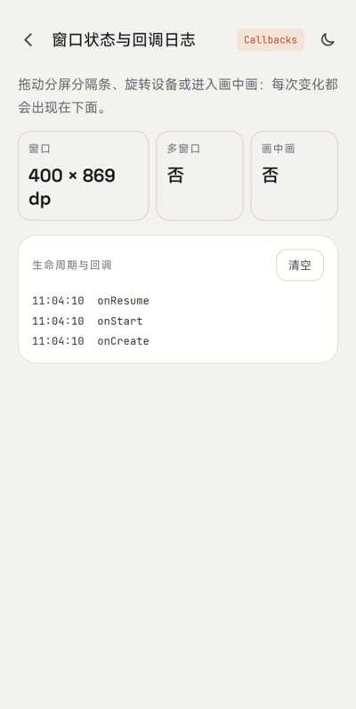
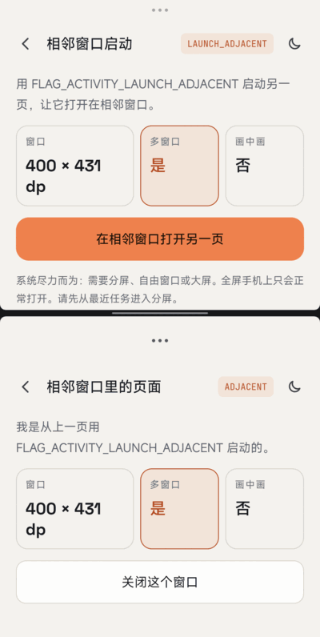
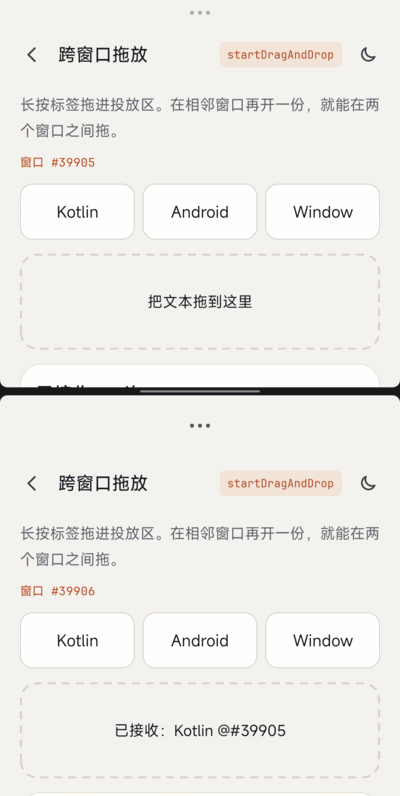
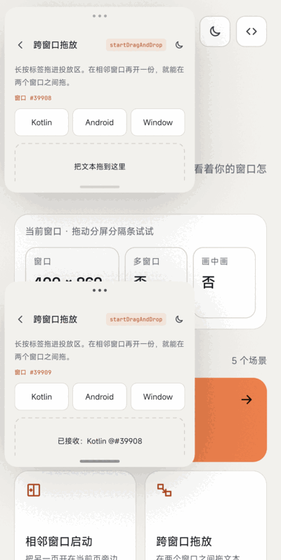
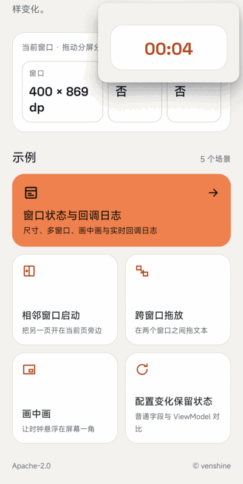
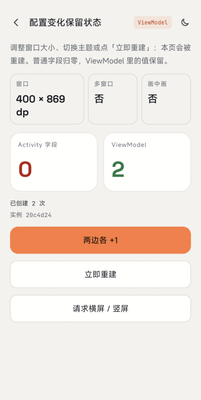

# MultiWindow

[](https://developer.android.com/guide/topics/manifest/uses-sdk-element#ApiLevels)

[中文](README-CN.md)

A Kotlin demo app for **multi-window and large-screen behavior** on Android: it shows the window size, multi-window and picture-in-picture state live, launches a page in the adjacent window, drags text across windows, and keeps its log across configuration changes. It is a demo app, not a library (no Maven coordinate).

- Version 2.0.0, minSdk 24, targetSdk 36, Kotlin, AppCompat DayNight (no Material Components).

[**Download the sample APK**](https://github.com/venshine/MultiWindow/releases/download/2.0.0/MultiWindow-sample-2.0.0.apk)

## Screenshot


| Home | Dark mode | Status & callbacks | Adjacent launch |
|:---:|:---:|:---:|:---:|
|  |  |  |  |

| Split-screen drag | Freeform drag | Picture-in-picture | ViewModel |
|:---:|:---:|:---:|:---:|
|  |  |  |  |

Captured on a Xiaomi 2509FPN0BC running Android 17 (API 37). Split screen comes from the adjacent-launch button, freeform windows from `adb shell am start --windowingMode 5`.

## What the demo covers

| Feature | Where |
|---|---|
| Live window size (`Configuration.screenWidthDp/HeightDp`), multi-window and PiP state | `BaseActivity`, `StatusActivity` |
| Callbacks: `onMultiWindowModeChanged(Boolean, Configuration)`, `onPictureInPictureModeChanged(Boolean, Configuration)` | `BaseActivity.onWindowEvent()` |
| Launch in the adjacent window: `FLAG_ACTIVITY_LAUNCH_ADJACENT or FLAG_ACTIVITY_NEW_TASK` | `AdjacentActivity` |
| Cross-window text drag and drop (`startDragAndDrop` + `DRAG_FLAG_GLOBAL`, `OnDragListener`) | `DragActivity`, `DropParser` |
| Keep state across recreation with `ViewModel` | `ConfigActivity`, `ConfigViewModel`, `WindowViewModel` |
| Handle configuration changes yourself (`configChanges`) + PiP | `PipActivity` (and `configChanges` in the manifest) |

```kotlin
// Query and callback (the single-argument overload is deprecated since API 26)
val inMultiWindow = isInMultiWindowMode
override fun onMultiWindowModeChanged(isInMultiWindowMode: Boolean, newConfig: Configuration) { ... }

// Open another activity in the adjacent window (best effort, not guaranteed)
startActivity(
    Intent(this, PeerActivity::class.java)
        .addFlags(Intent.FLAG_ACTIVITY_LAUNCH_ADJACENT or Intent.FLAG_ACTIVITY_NEW_TASK)
)
```

## What changed in Android (checked against the official docs)

All statements below were checked against the page quoted in the link.

1. **Android 12 (API 31) makes multi-window standard.** On large screens (medium / expanded window size class) all apps support multi-window regardless of configuration; `resizeableActivity="false"` puts the app in compatibility mode when needed. On small screens the system checks `minWidth` / `minHeight`, and `resizeableActivity="false"` still blocks multi-window. [Support multi-window mode](https://developer.android.com/develop/ui/compose/layouts/adaptive/support-multi-window-mode)
2. **Android 12L (API 32):** the Recents screen gets a **Split** action, and `FLAG_ACTIVITY_LAUNCH_ADJACENT` can make a full-screen app enter split-screen and open the target in the adjacent window (same page, "Programmatic split-screen"). OEMs can enable this behavior on older versions.
3. **Multi-resume (Android 10+):** all visible activities stay `RESUMED` in multi-window; use `onTopResumedActivityChanged()` for exclusive resources such as camera / microphone. Before Android 10 only the most recently used one is resumed. Same page.
4. **Android 16 (API 36), apps with targetSdk 36:** on displays with smallest width >= 600dp, `screenOrientation`, `resizeableActivity`, `minAspectRatio`, `maxAspectRatio`, `setRequestedOrientation()` and `getRequestedOrientation()` are ignored (the app is resizable and fills the window, no pillarboxing). Exceptions: games (`android:appCategory`), users who opt in to the app's default behavior in the aspect-ratio settings, and displays smaller than sw600dp. A temporary opt-out is `PROPERTY_COMPAT_ALLOW_RESTRICTED_RESIZABILITY`, and it will **not** work for apps targeting API 37. [Behavior changes: Android 16](https://developer.android.com/about/versions/16/behavior-changes-16), [App orientation, aspect ratio, and resizability](https://developer.android.com/develop/ui/compose/layouts/adaptive/app-orientation-aspect-ratio-resizability)
   - Consequence for this demo: the `resizeableActivity="true"` in `AndroidManifest.xml` only matters below sw600dp or below targetSdk 36; on large screens it is ignored. Rotation and window resizing recreate activities more often, so state must be preserved ([Save UI states](https://developer.android.com/topic/libraries/architecture/saving-states)).
5. **How to enable freeform (desktop) windows today:** the official docs only say desktop windowing "can be enabled by manufacturers of large screen devices" ([Support multi-window mode](https://developer.android.com/develop/ui/compose/layouts/adaptive/support-multi-window-mode)). The official developer-preview post says to use a Pixel Tablet on Android 15 QPR1 Beta 2 or the Pixel Tablet emulator, then select **Enable freeform windows** in Developer options; it does not mention root ([Android Developers Blog, Sep 2024](https://android-developers.googleblog.com/2024/09/developer-preview-desktop-windowing-on-android-tablets.html)). So the old recipe of rooting and running `settings put global enable_freeform_support 1` is no longer the documented path. **Observed on one real device (not official documentation):** on a Xiaomi 2509FPN0BC running Android 17 (API 37), `pm has-feature android.software.freeform_window_management` returns true, the `enable_freeform_support` global setting is unset, and `adb shell am start --windowingMode 5 -n <activity>` opens the activity as a freeform window (two such windows can be resized with `am task resize` and dragged between). The stable-release steps for end users and the availability on other devices or OEM builds are still **pending confirmation**.

## Migration from 1.x (Android N demo)

- Rewritten in Kotlin; `compileSdk` / `targetSdk` 36, `minSdk` 24 (unchanged).
- Dropped the `com.wx.android.common` dependency and the old support library; the old log buffer (a static `StringBuilder`) is replaced by a `ViewModel`.
- Drag and drop now carries plain text only (the old image drag is removed).
- Not applicable: Android N-only instructions in the old README (rooting for freeform mode); see item 5 above.

## Alternatives

For apps with multiple panes use [Activity embedding](https://developer.android.com/develop/ui/views/layout/activity-embedding) (Jetpack WindowManager); for adaptive layouts use [window size classes](https://developer.android.com/develop/ui/compose/layouts/adaptive/window-size-classes). Google's old [MultiWindowPlayground](https://github.com/googlesamples/android-MultiWindowPlayground) sample is the official reference for Android N.

## Maintenance

Maintained as a small demo. Adjacent launch (it produced a real top/bottom split screen), cross-window drag, PiP and freeform windows were checked by hand on a Xiaomi 2509FPN0BC running Android 17 (API 37); they are not covered by the automated tests and other devices were not tried.

## Credits

The sample app bundles these fonts, both licensed under the [SIL Open Font License 1.1](https://openfontlicense.org) (license texts in [`app/licenses/`](app/licenses)):

* [Space Grotesk](https://github.com/floriankarsten/space-grotesk): Copyright 2020 The Space Grotesk Project Authors
* [JetBrains Mono](https://github.com/JetBrains/JetBrainsMono): Copyright 2020 The JetBrains Mono Project Authors

## License

Apache License 2.0, see [LICENSE](LICENSE).
